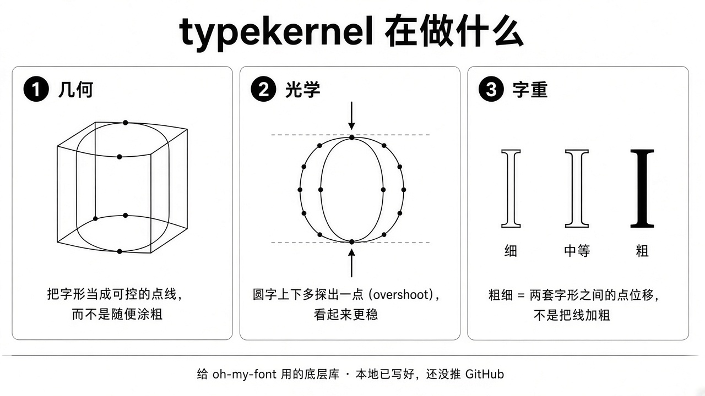
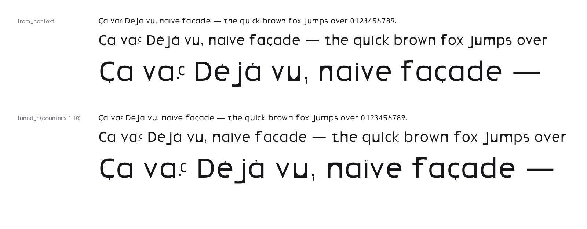
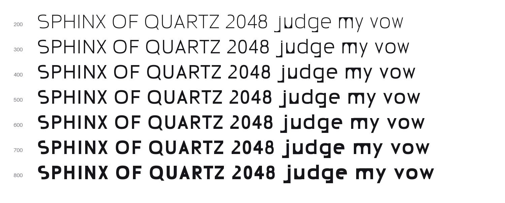
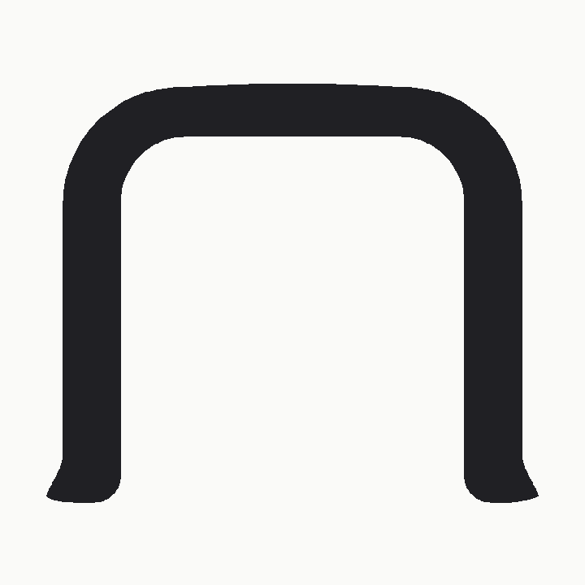
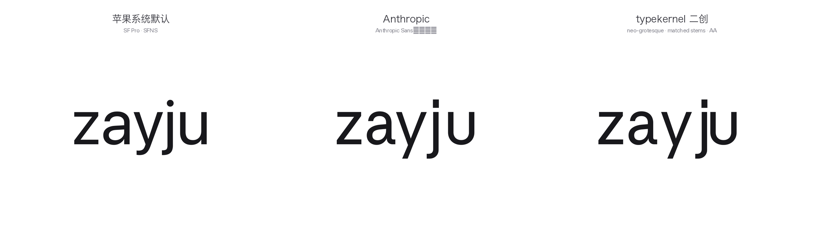

# typekernel

**用代码写成熟字族的光学 / 设计语义内核** — optical design-semantics kernel for fonts-as-code.  
Depends on [fontTools](https://github.com/fonttools/fonttools); **does not** rebuild OpenType tables.

> 自建设计层，编译层坐在 fontTools 上。不是编辑器，不是又一个 fontmake 包装器。

## 一眼看懂



*几何 → 光学外扩 → 字重用点位移（不是涂粗）。*

## 是什么 / 不是什么

| 是 | 不是 |
| --- | --- |
| 可编程的几何核 + 光学原语（overshoot、stem、对比、接合） | Glyphs / FontForge 式 GUI |
| 字重 / 轴作为 **designed deltas** 的语义层 | 「描边膨胀 = 字重」的脚本合集 |
| 导出到 UFO / designspace，再经 fontTools 编译 | 重造 OT 表、TTX、varLib、feaLib |
| 日后给 [oh-my-font](https://github.com/SheathedSharp/oh-my-font)（LihuiT / zayJu）与其他项目复用的地基 | 成品字族发行仓 |

## 分层（目标）

```
geo-kernel  →  type-semantics  →  compile (fontTools / UFO / designspace)
三次曲线核      光学与字族轴语义      OT 表与二进制：不重造，只依赖
```

## 状态

版本仍是 `0.0.0`。已落地：

- **几何核**（`typekernel.geo`）— 三次曲线轮廓、路径构建、笔桥；可选 boolean 并集（`skia-pathops`）
- **零件组装**（`typekernel.parts`）— 共享 `DesignContext` + Stem/Bowl/Arch 等零件，像搭积木组字
- **光学原语**（`typekernel.optics`）— overshoot 等（合成 O 标本已过人审）
- **字重 / 轴**（`typekernel.axes`）— `WeightDelta`、masters、`.designspace` 导出（点位移，不是涂粗）

- **字体模型**（`typekernel.font`）— `Font` / `Glyph` / `FontInfo`：字形名、码位、锚点、组件、字偶组、特性代码；竖直度量与对齐区从 `DesignContext` 推出

**编译桥**（`typekernel.compile`）— `build_font` / `build_variable_font` → OTF、TTF、可选 WOFF2；UFO 回流 `read_font_from_ufo`；斜体 oblique 母版 `oblique_font`；基础 `tnum` 特性文本。人审见 `approvals/compile-bridge.json`。

**推荐路径**：`DesignContext` → `Controls.build_all()` → `space_font` → `Font` → `build_font` / `build_variable_font`。实验性 `parts/latin.py`、`skel_*` 已标弃用。

**校样**（`typekernel.qa.proof`）— 从编译后的字体路径排瀑布、间距串、字偶对与字符网格。

## 做一个能安装的字体

[`examples/first_font/`](examples/first_font/) 从比例走到 OTF / TTF，并用编译出的字体排校样：

```python
from typekernel.compile import build_font
from typekernel.font import Font
from typekernel.parts import Controls, DesignContext

ctx = DesignContext.code_clear()
controls = Controls.from_context(ctx).tuned_n(counter=290)  # 控制表：改 n，h m r u 跟着变
font = Font.from_context(ctx, "My Sans")          # 含 .notdef、space、度量、对齐区
font.add_chars(controls.build_all())              # a–z from n / o, A–Z from H / O
build_font(font, "out/")                          # MySans-Regular.ufo / .otf / .ttf
```



多字重：每个字重从自己的控制表画出母版，`build_variable_font` 检查母版兼容后编成可变字体，见 [`examples/variable_family/`](examples/variable_family/)：



**质量 / 样品**（`typekernel.qa`）— 轮廓稳定哈希、PNG 预览样品（仅供人眼看，三次曲线仍是真相）、人审记录辅助。合成 O 样品：


愿景摘要：[docs/VISION.md](docs/VISION.md)。**Coding agent 字体创作目标**：[docs/AGENT_GOAL.md](docs/AGENT_GOAL.md)（工作流见 [.agents/skills/typekernel-font-design/](.agents/skills/typekernel-font-design/SKILL.md)）。开发约定：[docs/dev-standards.md](docs/dev-standards.md)。

## 动手试一颗字

[`examples/zayju_letter/`](examples/zayju_letter/) 用公开 API 画了一颗受 zayJu 启发的小写 **n**（三次曲线手搭，不是描边膨胀）：



```bash
pip install -e ".[dev,specimen,compile]"
python examples/zayju_letter/design_n.py
```


## 三栏对比：用零件组装「zayju」



```bash
pip install -e ".[dev,specimen,boolean]" && pip install brotli
python examples/anthropic_zayju/design_zayju.py
```

## 安装（占位）


```bash
# 尚未发布到 PyPI；本地可编辑安装：
pip install -e ".[dev]"
```

需要 Python ≥ 3.11；运行时依赖 `fonttools`。写 UFO / 编 TTF 时再装可选 extra：`pip install -e ".[compile]"`。

## 文档

| Doc | 内容 |
| --- | --- |
| [docs/VISION.md](docs/VISION.md) | 产品愿景 |
| [docs/dev-standards.md](docs/dev-standards.md) | 提交信息、typing、几何原则、公开 API 纪律 |
| [docs/notes/fonttools-reuse.md](docs/notes/fonttools-reuse.md) | fontTools / pathops 复用对照 |
| [docs/compile/build-manifest.md](docs/compile/build-manifest.md) | 编译产物 BuildManifest 字段说明 |
| [approvals/geo-public-api.json](approvals/geo-public-api.json) | Geo 公开 API 人审记录 |
| [approvals/optical-overshoot.json](approvals/optical-overshoot.json) | Overshoot 人审记录 |

## 贡献

先读 [docs/VISION.md](docs/VISION.md) 与 [docs/dev-standards.md](docs/dev-standards.md)。
合并前跑通 `pytest -q`、`ruff check src tests`、`mypy -p typekernel`。
Issue / PR 模板与行为准则后续再加。

## 许可

[MIT](LICENSE) © 2026 zayju
